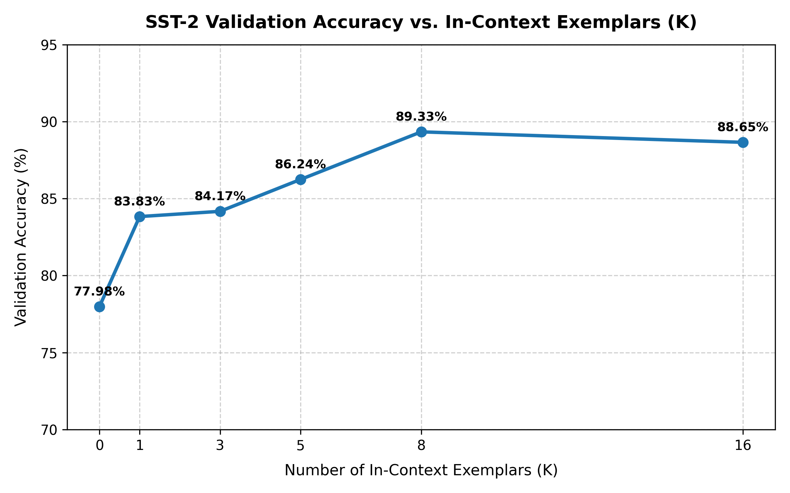

# In-Context Learning (ICL) & Prompt Sensitivity Analysis on SST-2

This repository implements a systematic evaluation pipeline to investigate **In-Context Learning (ICL)** and prompt sensitivity using the base language model **Qwen3-0.6B-Base** on the Stanford Sentiment Treebank (**SST-2**) dataset.

Developed for **ECS 189G: Large Foundation Models**.

---

##  Project Overview

Base language models (such as `Qwen3-0.6B-Base`) are trained purely for causal next-token prediction without instruction fine-tuning. Consequently, evaluating them on downstream tasks like binary sentiment classification ($0 = \text{Negative}$, $1 = \text{Positive}$) presents two main challenges:
1. **Dynamic In-Context Exemplar Construction:** Constructing balanced $K$-shot prompt templates dynamically from training data.
2. **Output Parsing:** Extracting exact classification target labels (`Positive` or `Negative`) from an continuous, unconstrained output stream that may hallucinate subsequent review blocks.

This project implements solutions for both challenges, runs an ICL scaling curve analysis across $K \in \{0, 1, 3, 5, 8, 16\}$, and evaluates prompt robustness against structural layout shifts and target label word variations.

---

##  Key Pipeline Components

### 1. Dynamic $K$-Shot Prompting (`k_shot_prompting`)
* Dynamically samples $K$ random exemplars from `train.json`.
* Maps integer class labels (`0`, `1`) to natural language descriptors (`Negative`, `Positive`).
* Formats exemplars using a structured key-value format (`Review: ... \n Sentiment: ...`) and appends the validation target query ending with `Sentiment:`.

### 2. Output Parsing Engine (`parse_sentiment`)
* Handles base model text continuations by isolating the immediate text generated post-`Sentiment:`.
* Truncates at the first newline (`\n`) to prevent parser corruption from model-hallucinated review exemplars.
* Performs normalized string matching (`startswith` and keyword search) with a robust fallback return for unparseable output tokens.

---

##  Empirical Results & Analysis

### 1. ICL Scaling Performance ($K$-Shot Curve)

Evaluated across the 872 SST-2 validation samples:

| In-Context Exemplars ($K$) | Validation Accuracy (%) | Performance Delta |
| :---: | :---: | :---: |
| **$K=0$ (Zero-Shot)** | 77.98% | Baseline |
| **$K=1$** | 83.83% | **+5.85%** |
| **$K=3$** | 84.17% | +0.34% |
| **$K=5$** | 86.24% | +2.07% |
| **$K=8$** | **89.33%** | **+3.09% (Peak)** |
| **$K=16$** | 88.65% | -0.68% (Saturation) |



#### Key Takeaways:
* **Format Priming ($K=0 \rightarrow K=1$):** The steepest accuracy jump occurs when introducing a single exemplar (+5.85%), confirming that prompt formatting rapidly constrains the base model's next-token vocabulary.
* **Optimal Context ($K=8$):** Accuracy reaches its peak at **89.33%** with 8 in-context exemplars.
* **Context Saturation ($K=16$):** Beyond 8 shots, accuracy slightly degrades to 88.65%. For a small 0.6B model, excessively long contexts introduce positional distraction, surface-level feature overfitting, and attention dilution across key-value (KV) representations.

---

### 2. Robustness & Prompt Sensitivity ($K=3$)

Tested across layout shifts and target label mapping modifications:

| Experiment Variation | Format Template | Target Labels | Accuracy (%) |
| :--- | :--- | :---: | :---: |
| **Baseline** | `Review: [Text] \n Sentiment:` | `Positive / Negative` | **86.24%** |
| **Format Shift** | `Input: [Text] \| Label:` | `Positive / Negative` | **87.39%** |
| **Label Word Shift (Adjectives)** | `Review: [Text] \n Sentiment:` | `Good / Bad` | 74.43% |
| **Label Word Shift (Digits)** | `Review: [Text] \n Sentiment:` | `1 / 0` | 76.03% |

#### Sensitivity Analysis Discussion:
`Qwen3-0.6B-Base` displays high resilience to structural delimiter changes (+1.15% boost under `Input: | Label:` format), but suffers a severe **10–12% performance drop** when target label words are shifted to `Good/Bad` or `1/0`. This sharp degradation occurs because base language models depend heavily on pre-trained conditional probability distributions where terms like `"Positive"` and `"Negative"` are strongly associated with sentiment evaluation contexts. Swapping natural descriptors for digits or alternative adjectives disrupts these pre-trained semantic priors.

---

##  Repository Structure

```text
.
├── DATA/
│   └── SST2/
│       ├── train.json       # SST-2 training set (67,349 items)
│       └── val.json         # SST-2 validation set (872 items)
├── Qwen3-0.6B-Base/         # Pre-trained base model & tokenizer weights
├── eval_sst2.py             # Main ICL K-shot evaluation loop script
├── eval_robustness.py       # Prompt format and label sensitivity benchmark
├── plot_kshot.py            # Accuracy vs. K-shot visualization script
├── requirements.txt         # Python dependencies list
├── Report.pdf               # Compiled report with observations and analysis
└── README.md                # Project documentation
```

---

##  Setup & Execution

### 1. Environment Setup

It is recommended to use a virtual environment (`venv` or `Conda`):

```bash
# Create and activate virtual environment
python3 -m venv venv
source venv/bin/activate  # On Windows: venv\Scripts\activate

# Install required packages
pip install -r requirements.txt
```

### 2. Run $K$-Shot Evaluation Loop

To run the evaluation across $K \in \{0, 1, 3, 5, 8, 16\}$:

```bash
python3 eval_sst2.py
```

### 3. Generate Scaling Curve Plot

To generate and save the `kshot_accuracy_curve.png` plot:

```bash
python3 plot_kshot.py
```

### 4. Run Sensitivity Analysis

To execute the format shift and label word shift experiments:

```bash
python3 eval_robustness.py
```

---

##  Author & Course Information

* **Author:** Param Desai
* **Instructor:** Prof. Lifu Huang
* **Course:** ECS 189G: Large Foundation Models
* **Model:** Qwen3-0.6B-Base
* **Dataset:** Stanford Sentiment Treebank (SST-2)
